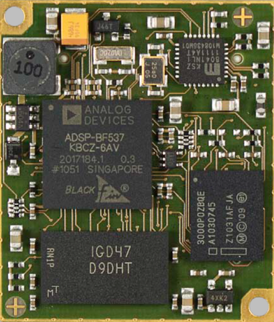

# Blackfin SOM — ADSP-BF548 System-on-Module

A compact **System-on-Module (SOM)** built around the Analog Devices **ADSP-BF548 Blackfin** DSP, designed for the **Mars Robotics** project. The board is inspired by Bluetechnix's **CM-BF548** core module and follows its connector form factor so it can be dropped onto existing carrier boards.

<p align="center">
  
</p>

| | |
|---|---|
| **Processor** | ADSP-BF548BBCZ-5A (Blackfin, up to 533 MHz) |
| **Schematic revision** | V1I1 — Variant `ORIGIN` (24 Jan 2021) |
| **PCB release** | v1.2 (Bluetechnix form factor) |
| **EDA tool** | Altium Designer 20 |
| **Supply** | single external +3.3 V |

---

## Table of contents

- [Project goals](#project-goals)
- [Hardware overview](#hardware-overview)
- [Interfaces on the expansion connector](#interfaces-on-the-expansion-connector)
- [Schematic sheets](#schematic-sheets)
- [Repository layout](#repository-layout)
- [Getting started](#getting-started)
- [Release procedure](#release-procedure)
- [Roadmap](#roadmap)
- [References](#references)

---

## Project goals

The full project definition is in [`Mars Robotic SOM project.pdf`](Artifacts/Datasheets/Blackfin/Mars%20Robotic%20SOM%20project.pdf).

**Milestone 1 — DSP core module**

- ADSP-BF548 DSP
- DDR SDRAM and non-volatile flash memory
- Reset circuitry
- External ADC (≥ 8 channels, ≥ 10 kHz)
- Power Management IC (PMIC)

Design rules for milestone 1:

- Board size may differ from the CM-BF548 to make room for extra parts.
- The pinout may differ from the CM-BF548; unused BF548 peripherals (MXVR, audio, …) may be left off the headers and replaced with new signals (e.g. ADC pins).
- The card is fed with an external **+3.3 V**.
- All UART channels are **TTL** level.

**Milestone 2 — FPGA co-processor**

An FPGA is added on the card and connected directly to the DSP. This changes the power budget, so the power-management design will be revisited.

---

## Hardware overview

```
              +3V3 (external)
                   │
        ┌──────────┴───────────┐
        │  Power               │  LDO  +3V3 → +2V5 (DDR)
        │                      │  Buck (FDS9926A, on-chip VROUT ctrl) → VDD_INT (core)
        └──────────┬───────────┘
                   │
 ┌──────────┐   ┌──┴───────────────────┐   ┌───────────────────────┐
 │ 25 MHz   ├──►│                      │◄─►│ DDR SDRAM             │
 │ oscillator│  │   ADSP-BF548BBCZ-5A  │   │ MT46V32M16 (64 MB x16)│
 ├──────────┤   │       Blackfin       │   └───────────────────────┘
 │ 32.768kHz├──►│                      │   ┌───────────────────────┐
 │ RTC xtal │   │                      │◄─►│ Parallel flash        │
 ├──────────┤   │                      │   │ PC28F128P33 (16 MB)   │
 │ TCM809   ├──►│ RESET                │   └───────────────────────┘
 │ supervisor│  └──┬───────────────┬───┘
 └──────────┘      │               │
          Connector X1-A     Connector X1-B
```

| Block | Part | Notes |
|---|---|---|
| DSP | **ADSP-BF548BBCZ-5A** | 400-ball CSP-BGA |
| DDR SDRAM | **Micron MT46V32M16CY-5B IT:J** | 512 Mbit (32M × 16) DDR, +2.5 V, 22 Ω series termination (CAY16 arrays) on address/data/control, 33 Ω on DQS; VREF from resistor divider |
| Flash | **Micron/Intel PC28F128P33BF60A** | 128 Mbit StrataFlash P33, 16-bit async/sync burst on AMS0, boot device |
| System clock | 25 MHz oscillator (Y1) | 33 Ω series resistor to `CLKIN` |
| RTC clock | 32.768 kHz crystal (Y2) | 10 MΩ / 18 pF load |
| Reset | **TCM809SENB713** supervisor | drives `RESET` and `FLASH_RST` |
| +2V5 rail | LDO (U5) | DDR supply and VDDDDR |
| VDD_INT rail | **FDS9926A** dual MOSFET + 10 µH + ZHCS1000 Schottky | switched by the BF548 on-chip regulator (`VROUT0/1`) |
| Decoupling | 10 µF + 0.01 µF arrays | on VDDEXT (+3V3) and VDD_INT |

---

## Interfaces on the expansion connector

All interfaces are routed to the two-row **X1 connector** (CM-BF548 / Bluetechnix compatible footprint):

| Group | Signals |
|---|---|
| Power | +3V3 (×3), GND, `VDD_RTC`, +2V5, GND shield |
| Boot | `BMODE0..3` |
| Reset / misc | `RESET`, `NMI`, `EXT_WAKEUP`, `CLKBUF`, `CLKOUT` |
| JTAG | `TRST`, `TMS`, `TCK`, `TDI`, `TDO`, `EMU` |
| UART (TTL) | UART0, UART1, UART2, UART3 |
| CAN | CAN0, CAN1 |
| I²C (TWI) | `SCL1`, `SDA1` |
| SPI | SPI0 / SPI1 / SPI2 (on PE / PG / PB ports) |
| SD/MMC | `SD_D0..3`, `SD_CLK`, `SD_CMD` |
| Timers | `TMR0..10`, `TACLK6` |
| USB OTG | `USB_D+`, `USB_D-`, `USB_VBUS`, `USB_ID` |
| External bus | `A1..A15`, `D0..D15`, `AMS1..3`, `ABE0/1`, `AOE`, `ARE`, `AWE`, `ARDY` |
| ATAPI / NAND / PPI / GPIO | Ports PA–PJ broken out (ATAPI, NAND (`ND_CE`, `ND_RB`), PPI0–2, host DMA, keypad) |

> The complete pin map is in [`Design/[07] - EXPANSION INTERFACE AND JTAG.SchDoc`](Design/) and page 7 of the released schematic PDF.

---

## Schematic sheets

The released schematic is [`Release/Schematic Diagrams/schematics.PDF`](Release/Schematic%20Diagrams/schematics.PDF).

| Page | Sheet | Content |
|---|---|---|
| 1 | Cover Page | index, revision V1I1, variant ORIGIN |
| 2 | Block Diagram | power, DSP, RAM, flash, connectors |
| 3 | ADSP | BF548 port banks, USB, MXVR |
| 4 | RAM Interface | DDR SDRAM + series termination + VREF |
| 5 | Flash Memory Interface | P33 parallel flash on async bus |
| 6 | Boot Control | clocks, RTC crystal, reset supervisor, BMODE, JTAG, peripheral ports |
| 7 | Expansion Interface and JTAG | connector X1 pin assignment |
| 8 | Push Buttons, LEDs and Reset | *(reserved)* |
| 9 | Power | rails, on-chip regulator, decoupling |
| 10 | Doc Revision History | |

---

## Repository layout

```
BLACKFIN-SOM/
├── Design/                 Altium project (SOM.PrjPcb), schematics (*.SchDoc), PCB (*.PcbDoc),
│                           libraries (BlackfinSOM.SchLib / .PcbLib), design rules, output jobs
├── Libs/                   Vendor component models (symbols, footprints, 3D STEP) per part number
├── Release/                Frozen manufacturing outputs — DO NOT EDIT
│   ├── Schematic Diagrams/ released schematic PDF
│   ├── PCB Manufacturing/  Gerbers / NC drill (Bluetechnix form factor) + BOM (SOM-BOM.xlsx)
│   ├── Board Assembly/     assembly drawings
│   ├── 3D/                 3D model exports
│   └── Firmware/           firmware images
├── Artifacts/
│   ├── Datasheets/         component datasheets (BF54x, DDR, flash, regulators …)
│   ├── Design Guides/      ADI EE-notes, layout & memory interface guides
│   ├── Development Boards/ ADSP-BF548 EZ-KIT Lite, Bluetechnix DEV/EVAL boards
│   ├── Competition and Similar Products/  CM-BF548 hardware user manual
│   ├── Errata/             design reviews and comments
│   └── Reports/            project definition, design reports, Q&A
├── Assets/                 images and helper software
└── Templates/              Altium sheet / project templates
```

---

## Getting started

1. Install **Altium Designer 20** (or newer).
2. Clone the repository:
   ```bash
   git clone https://github.com/altay-brusan/blackfin-som.git
   ```
3. Open `Design/SOM.PrjPcb`.
4. The top-level sheet is `SystemOnModule.SchDoc`; the production PCB is `SOM_PCB_BLUETECHNIX.PcbDoc`.
5. Component models live in `Libs/` and `Design/BlackfinSOM.*Lib` — add them to the project if Altium cannot resolve a footprint.

---

## Release procedure

Files under `Release/` are **frozen** once a board is sent to production:

- Never change or work directly on files inside `Release/`.
- For a new board issue, copy the released files as a starting point.
- Before releasing, follow the checklist in [`Release/!!! IMPORTANT !!! Release Document for Altium Designer.txt`](Release/): compile, update PCB, check impedance, repour polygons, run DRC, verify Gerbers, and sign each step.

---

## Roadmap

- [x] BF548 core, DDR SDRAM, flash, reset, clocks — schematic V1I1
- [x] PCB v1.2 in Bluetechnix form factor sent to manufacturer
- [ ] Phase 1 bring-up on external +3.3 V (without PMIC)
- [ ] Phase 2: add and evaluate the power management unit
- [ ] External 8-channel ADC
- [ ] Push buttons / LEDs sheet
- [ ] Milestone 2: FPGA integration and power re-design

---

## References

- [ADSP-BF542/544/547/548/549 datasheet](Artifacts/Datasheets/Blackfin/ADSP-BF542_BF544_BF547_BF548_BF549.pdf)
- [ADSP-BF54x Blackfin Processor Hardware Reference](Artifacts/Datasheets/Blackfin/ADSP-BF54X%20Blackfin%20Processor%20Hardware%20Reference.pdf)
- [ADSP-BF54x Hardware Reference rev 1.2](Artifacts/Datasheets/Blackfin/ADSP-BF54x_hwr_rev1.2.pdf)
- [Bluetechnix CM-BF548 Hardware User Manual](Artifacts/Competition%20and%20Similar%20Products/CM-BF548_HUM_V1.pdf)
- [ADSP-BF548 EZ-KIT Lite](Artifacts/Development%20Boards/ADSP-BF548%20EZ-KIT%20Lite)
- ADI application notes in [`Artifacts/Design Guides`](Artifacts/Design%20Guides)

---

*Mars Robotics — Blackfin DSP System-on-Module.*
